<picture>
  <source media="(prefers-color-scheme: dark)" srcset="docs/assets/kapak-tr-koyu.svg">
  
</picture>

<sub>Dış halkanın altı parçası sistemin altı temel özelliğidir. İlki hafızadır ve tamamdır. Öteki beşi yolda: bir özellik eklendiğinde adı yazılır ve parçası dolar. Altısı da dolduğunda sürüm 1.0.0 çıkar: <a href="#yol-haritasi">yol haritası</a>.</sub>

**COUNCIL, yapay zekâ yardımcılarına kalıcı hafıza veren açık kaynak bir sistemdir.** Bilgisayarında çalışır ve notların düz Markdown dosyaları olarak sende kalır. Tek bir yardımcıya bağlı değildir: kullandığın bütün yardımcılar aynı hafızayı okur ve yazar.

Kurmak için şu cümleyi yapay zekâ yardımcına yapıştır. Gerisini o yapar:

```text
Şu yönergeyi oku ve COUNCIL'i kur:
https://raw.githubusercontent.com/musalkeremlboz/council/main/INSTALL.md
```

**[Kurulum](#kurulum)** · [Nasıl çalışır](#nasil-calisir) · [Yol haritası](#yol-haritasi) · [Desteklenen yardımcılar](#desteklenen-yardimcilar) · [Sık sorulanlar](#sik-sorulanlar) · [English](README.en.md)

macOS · Linux · Windows &nbsp;|&nbsp; Python 3.11+ &nbsp;|&nbsp; sürüm 0.2.1 &nbsp;|&nbsp; [MIT lisansı](LICENSE)

<br>

<a id="ne-ise-yarar"></a>
<p><picture><source media="(prefers-color-scheme: dark)" srcset="docs/assets/baslik-ne-ise-yarar-koyu.svg"></picture></p>

Yapay zekâ yardımcıları sohbet bitince her şeyi unutur. COUNCIL bu boşluğu doldurur:

| Bugün | COUNCIL ile |
|---|---|
| Her yeni sohbet sıfırdan başlar. Kim olduğunu ve ne üzerinde çalıştığını yeniden anlatırsın. | Oturum açılır açılmaz profilin, kuralların, açık işlerin ve son oturumların yardımcının önüne gelir. |
| Her yardımcı kendi hafızasını tutar. Birine anlattığını öbürü bilmez. | Hafıza tek yerde durur. Bağlanan her yardımcı aynı notları görür. |
| "Bunu hatırla" demen gerekir. Demezsen kaybolur. | Yardımcı kararını, tercihini ve düzeltmeni söylediğin anda kendisi kaydeder. |
| Aynı hatayı tekrar tekrar düzeltirsin. | Düzeltmen tarihli tek satır olarak kurallara girer ve sonraki her oturumda yüklenir. |
| Yeni bir sisteme geçince eski notların geride kalır. | Kurulum, yardımcılarının bugüne dek tuttuğu hafızayı bulur ve içeri alır. |
| Hafızanın ne bildiğini ve neye dayandığını göremezsin. | Notlar düz metindir. Her değişiklik ne zaman ve neden yapıldığıyla birlikte geçmişte durur. |

<br>

<a id="nasil-calisir"></a>
<p><picture><source media="(prefers-color-scheme: dark)" srcset="docs/assets/baslik-nasil-calisir-koyu.svg"></picture></p>

COUNCIL bilgisayarında küçük bir servis olarak çalışır ve notlarını bir klasörde tutar. Yardımcın her oturumda hafızaya üç kez uğrar:

<picture>
  <source media="(prefers-color-scheme: dark)" srcset="docs/assets/akis-tr-koyu.svg">
  
</picture>

Turuncu çizgi hafızadır: bilgisayarındaki not dosyaları. Her yay bir oturumdur: hafızadan çıkar, hafızaya döner. Turuncu noktalar hafızadan oturuma giden notlardır. Yayın ucundaki nokta oturumun hafızaya yazdığıdır. Sonraki oturum bir öncekinin bıraktığı yerden başlar.

1. **Başlarken okur.** Oturum açıldığında başlangıç bağlamı yardımcının önüne gelir: kim olduğun, düzeltmelerin, açık konuların ve son iki oturumun kartı. Hepsi 9.000 karakterlik bir bütçeye sığar. Sığmayan sessizce atılmaz, adıyla bildirilir.
2. **Her mesajda yalnız ilgili notları alır.** Mesajın hafızada aranır ve en ilgili en çok beş bölüm mesaja eklenir (3.500 karaktere kadar). Aynı bölüm bir oturumda yalnız bir kez gönderilir.
3. **Bitince yazar.** Anlamlı bir iş bittiğinde yardımcı oturum kartını yazar: ne yapıldı, neden, hangi kararlar verildi, ne açık kaldı, sıradaki adım ne. Kaydetmeden bitirmeye kalkarsa bir kez hatırlatılır.

Oturum olaylarına bağlanabilen yardımcılarda bu üç an kendiliğinden gerçekleşir. Ötekiler aynı işi hafızanın araçlarını çağırarak yapar. Hangisinin nasıl bağlandığı [desteklenen yardımcılar](#desteklenen-yardimcilar) bölümünde.

### Altında ne var

| Parça | Ne yapar |
|---|---|
| **Notlar** | Bilgisayarındaki ya da sunucundaki bir klasörde düz Markdown dosyaları. Tek doğru kaynak budur. |
| **Geçmiş** | Her değişiklik bir git commit'idir (değişikliğin tarihli kaydı). Eski hâl geri getirilebilir. |
| **Arama** | SQLite FTS5 tam metin indeksi. Türkçe harfleri sadeleştirir: "şifre" ile "sifre" aynı sonucu verir. İndeks silinirse notlardan yeniden kurulur. |
| **Bağlantı** | MCP (yardımcıların dış araçlara bağlanma standardı) üzerinden sekiz araç. Oturum olaylarına bağlanabilen yardımcılar için ayrıca üç hook (yardımcının belirli anlarda kendiliğinden çalıştırdığı küçük betik). |
| **Çakışma koruması** | İki yardımcı aynı notu birbirinin üstüne yazamaz. Yazan, okuduğu sürümün özetini geri verir. Not o arada değiştiyse yazma reddedilir. |
| **Güncelleme** | Günde bir kez yayınlanmış son sürüme bakar. Yenisi varsa kurar ve servisi yeniden başlatır. Notlara dokunmaz. |
| **Yedek** | `council backup`, notları geçmişiyle birlikte kendi özel git depona gönderir. Yedek iki gün başarısız kalırsa yardımcı seni uyarır. |

<details>
<summary><b>Sekiz MCP aracı</b></summary>

| Araç | Ne yapar |
|---|---|
| `council_context` | Oturum başı bağlamını yükler |
| `council_search` | Bütün notlarda tam metin arar |
| `council_read` | Bir notu ve sürüm özetini okur |
| `council_list` | Not yollarını listeler |
| `council_write` | Yeni not yazar ya da bir notu bütünüyle değiştirir |
| `council_edit` | Bir notun bir bölümünü değiştirir |
| `council_session` | Oturumun kartını yazar |
| `council_log` | Biten işi, değişen notlarla birlikte günlüğe işler |

</details>

### Ölçümler

2026-11-16'da bir Linux sunucuda, 44 soruluk bir soru setiyle ölçüldü. Örnek küçüktür. Kendi notlarınla sonuç değişir.

| Ölçüm | Sonuç |
|---|---|
| Oturum başı bağlamının hazırlanması | 4,8 ms (ortanca) |
| Hook'un uçtan uca süresi | yaklaşık 250 ms, neredeyse tamamı Python'ın açılışı |
| 13.000 bölümlük deneme kasasında arama | 12 ms (ortanca) |
| Cevabın, yardımcı hiç arama yapmadan bağlamda hazır bulunması | 44 sorunun %84'ü |
| Tekrar engellemenin 10 mesajlık sohbete etkisi | eklenen bağlam %68 azaldı |
| Servisin bellek kullanımı | yaklaşık 70 MB |

<br>

<a id="yol-haritasi"></a>
<p><picture><source media="(prefers-color-scheme: dark)" srcset="docs/assets/baslik-yol-haritasi-koyu.svg"></picture></p>

Kapaktaki dış halkanın altı parçası sistemin altı temel özelliğidir.

- **İlki hafızanın kendisidir ve doludur.** Notlar düz dosyalarda durur, her değişiklik geçmişe işlenir, kelimeyle aranır ve bağlam kendiliğinden gelir.
- **Öteki beşi yoldadır.** Adlarının yerinde kıpırdayan çizgiler durur: orası boş değildir, henüz yazılmamıştır.
- **Bir özellik eklendiğinde adı yazılır ve parçası dolar.** Altısı da dolduğunda sürüm 1.0.0 çıkar.

**Bir özellik ancak testlerini ve ölçümlerini geçtiğinde eklenir.** Örnek: anlam tabanlı arama denendi. Doğru notu ilk beş sonuçta bulma oranı %70'ten %89'a çıktı, ama 3,5 GB bellek ve sorgu başına 369 ms istedi. Küçük bir hafıza için bu bedel fazla olduğundan eklenmedi. Ölçütü tutturana kadar da eklenmeyecek.

<br>

<a id="neden-farkli"></a>
<p><picture><source media="(prefers-color-scheme: dark)" srcset="docs/assets/baslik-neden-farkli-koyu.svg"></picture></p>

- **Tek cümle, sıfır ayar.** Yardımcına bir cümle yazarsın; servis, bağlantı, içe aktarma ve güncelleme kendiliğinden kurulur. Yönetici yetkisi istemez.
- **Eski hafızanı geride bırakmaz.** Yardımcılarının tuttuğu hafıza dosyalarını kopyalar. Tanımadığı bir sistem varsa ilk oturumda yardımcın onu bulup taşır.
- **Kendini günceller.** Yeni sürüm yayınlandığında bir gün içinde sana ulaşır.
- **Yardımcıya bağlı değildir.** Hafıza yardımcının içinde değil, senin dosyalarındadır. MCP konuşan her yardımcı bağlanır.
- **Cihazlar arasında tek hafıza.** Sunucuya taşıdığında bütün cihazların aynı notları paylaşır. Eşitlenecek klasör yoktur.
- **Denetlenebilir.** Her şey düz metindir, her değişiklik geçmişte durur, iki yardımcı birbirinin üstüne yazamaz.

### İki kullanım biçimi

| | Bu bilgisayar | Kendi sunucun |
|---|---|---|
| **Kurulum** | Yardımcına tek cümle | [Rehberdeki adımlar](docs/kurulum.md#sunucu) |
| **Kimler bağlanır** | Bu bilgisayardaki yardımcılar | Bütün cihazların, telefon ve web dahil |
| **Ne gerekir** | Python ve git | Alan adı olan küçük bir Linux sunucu |

Bilgisayarında başlayıp sonradan sunucuya geçebilirsin. Taşımak için `vault/` klasörünü kopyalaman yeter.

<br>

<a id="desteklenen-yardimcilar"></a>
<p><picture><source media="(prefers-color-scheme: dark)" srcset="docs/assets/baslik-desteklenen-yardimcilar-koyu.svg"></picture></p>

COUNCIL belirli bir yardımcı için yazılmadı. MCP konuşan her yardımcı bağlanabilir. Bugünkü durum:

| Yardımcı | Nasıl bağlanır | Durum |
|---|---|---|
| **Claude Code** | Kurulum kendisi bağlar. Bağlam oturum olaylarıyla kendiliğinden gelir. | Tam destek. Kurulum her değişiklikte macOS, Linux ve Windows'ta denenir. |
| **claude.ai** (web, masaüstü, telefon) | Özel bağlayıcıyla. Hafızayı oturum başında bir araç çağrısıyla yükler. | Kullanılıyor. [Sunucu kurulumu](docs/kurulum.md#sunucu) ister. |
| **Hermes**, **Antigravity** | MCP araçlarıyla | Kullanılıyor |
| **Codex**, **Gemini CLI** | MCP araçlarıyla. Kurulum, tuttukları hafıza dosyalarını içeri alır. | İçe aktarma çalışıyor. Bağlantı henüz denenmedi. |
| **MCP konuşan diğer yardımcılar** | Yardımcı, [yönergedeki](INSTALL.md) adımla kendini bağlar | Denenmedi |

Yardımcın listede yoksa ve MCP konuşuyorsa kurulum cümlesini ona da yapıştırabilirsin. Çalışmayan bir şey görürsen [bildir](https://github.com/musalkeremlboz/council/issues).

<br>

<a id="kurulum"></a>
<p><picture><source media="(prefers-color-scheme: dark)" srcset="docs/assets/baslik-kurulum-koyu.svg"></picture></p>

**Yardımcına yaptır.** Şu cümleyi yapay zekâ yardımcına yapıştır:

```text
Şu yönergeyi oku ve COUNCIL'i kur:
https://raw.githubusercontent.com/musalkeremlboz/council/main/INSTALL.md
```

Yardımcın [yönergeyi](INSTALL.md) okur ve sana soru sormadan şunları yapar: gerekenleri denetler, kurulumu çalıştırır, sonucu doğrular, bildiği başka hafıza kaynaklarını içeri alır ve ne yaptığını birkaç satırla sana bildirir. Bittiğinde yeni bir oturum açman yeter.

<details>
<summary><b>Kendim kurmak istiyorum</b></summary>

Gerekenler: Python 3.11 ya da üstü ve git.

**macOS ve Linux**

```sh
curl -fsSL https://raw.githubusercontent.com/musalkeremlboz/council/main/install.sh | sh
```

**Windows** (PowerShell)

```powershell
irm https://raw.githubusercontent.com/musalkeremlboz/council/main/install.ps1 | iex
```

Komut bittiğinde yardımcınla yeni bir oturum aç. Hafıza hazırdır.

</details>

| Kurulum ne yapar | |
|---|---|
| **Kurar** | COUNCIL'i `~/.council` klasörüne, kendi Python ortamıyla kurar. Yönetici yetkisi istemez. |
| **Çalıştırır** | Servisi başlatır. Servis oturum açtığında kendiliğinden çalışır. |
| **Bağlar** | Yardımcını hafızaya bağlar. Var olan ayarlarını korur ve değiştirmeden önce yedeğini alır. |
| **İçe alır** | Yardımcılarının tuttuğu hafızayı bulur ve kopyalar. Kaynak dosyalara dokunmaz. |
| **Güncel tutar** | Günlük güncelleme denetimini açar. |

Sonrası için dört komut:

| Komut | Ne yapar |
|---|---|
| `council status` | Servis çalışıyor mu, hook'lar ve güncelleme açık mı |
| `council update` | Son sürümü hemen kurar |
| `council import KLASÖR` | Bir not klasörünü hafızaya alır |
| `council uninstall` | Servisi ve bağlantıları kaldırır. Notlarına dokunmaz. |

<details>
<summary><b>Var olan hafızam nasıl aktarılıyor?</b></summary>

İki adımda:

1. **Kurulum sırasında.** Yaygın yardımcıların ev klasöründe tuttuğu hafıza ve yönerge dosyaları ile çalıştığın klasörlerdeki not kasaları kopyalanır. Kopyalar `imported/` altına girer: aranabilir, ama her oturumda yüklenmez.
2. **İlk oturumda.** Kurulum hafızaya bir görev bırakır. Yardımcın bu bilgisayarda başka bir hafıza sistemi kullanılıp kullanılmadığına bakar, varsa onu taşır, kopyalananları da seninle birlikte yerlerine dağıtır: kalıcı bilgiler `core.md` dosyasına, düzeltmeler `rules.md` dosyasına, proje bilgisi proje notlarına.

Hiçbir adımda kaynak dosyalar değiştirilmez ya da silinmez. İçe aktarmayı istemiyorsan kurulumu `--no-import` ile çalıştır.

</details>

<details>
<summary><b>Otomatik güncelleme nasıl çalışıyor?</b></summary>

Günde bir kez bu deponun yayınlanmış son sürümüne bakılır. Yenisi varsa kurulur, servis yeniden başlar ve yardımcın bir sonraki oturumda sana haber verir. Notlarına dokunulmaz.

Yalnız yayınlanmış sürümler kurulur, depodaki ara değişiklikler kurulmaz. Kapatmak için kurulumu `--no-auto-update` ile çalıştır. O zaman `council update` ile kendin güncellersin.

</details>

<details>
<summary><b>Seçenekleri nasıl veririm?</b></summary>

```sh
curl -fsSL https://raw.githubusercontent.com/musalkeremlboz/council/main/install.sh | sh -s -- --no-auto-update
```

| Seçenek | Ne yapar |
|---|---|
| `--no-auto-update` | Otomatik güncellemeyi kapatır |
| `--no-import` | Var olan hafızayı aramaz |
| `--from KLASÖR` | Bulunanlar yerine bu klasörü içe alır |
| `--port 8765` | Servisin dinlediği kapıyı değiştirir |

</details>

<details>
<summary><b>Telefonumu ve öbür cihazlarımı da bağlamak istiyorum</b></summary>

Bunun için hafızanın internetten erişilen bir adreste durması gerekir. Küçük bir Linux sunucu ve bir alan adı yeter. Adımlar [kurulum rehberinde](docs/kurulum.md#sunucu). Bilgisayarındaki notları sunucuya taşımak için `vault/` klasörünü kopyalarsın.

</details>

<br>

<a id="ilk-bes-dakika"></a>
<p><picture><source media="(prefers-color-scheme: dark)" srcset="docs/assets/baslik-ilk-bes-dakika-koyu.svg"></picture></p>

| Adım | Yardımcına yaz | Ne olur |
|---|---|---|
| **Kendini tanıt** | "Adım Deniz, yazılımcıyım, cevapları kısa severim. Bunları hafızana yaz." | `core.md` dosyasına işlenir ve her oturumda yüklenir. |
| **Bir karar ver** | "Blog projesinde veritabanı olarak SQLite kullanmaya karar verdik." | Proje notuna tarihiyle yazılır. |
| **Yeniden sor** | Yeni bir oturumda: "Blog projesinde veritabanı kararımız neydi?" | Cevap, sen anlatmadan gelir. |
| **Bir kez düzelt** | "Teknik terimleri ilk geçtiği yerde açıkla." | `rules.md` dosyasına tarihli bir satır eklenir. Aynı düzeltmeyi bir daha yapmazsın. |

<br>

<a id="hafizanin-ici"></a>
<p><picture><source media="(prefers-color-scheme: dark)" srcset="docs/assets/baslik-hafizanin-ici-koyu.svg"></picture></p>

```text
vault/
├── core.md            kim olduğun ve kalıcı tercihlerin
├── rules.md           düzeltmelerin, her biri tarihli tek satır
├── threads.md         açık konular: şu anki durum ve sıradaki adım
├── sessions.md        son oturum kartları
├── sessions/          eski kartların aylık arşivi
├── projects/<ad>/     proje notları ve projeye özel kurallar
├── knowledge/         tek tek bilgi notları
├── imported/          başka sistemlerden kopyalanan notlar
└── log/               hangi iş yapıldı, hangi notlar değişti
```

İlk dört dosya her oturumun başında yüklenir. Geri kalanı yalnız konuyla ilgili olduğunda gelir. Hepsi düz metindir: herhangi bir düzenleyiciyle açıp okuyabilir, elle düzeltebilirsin.

<br>

<a id="sik-sorulanlar"></a>
<p><picture><source media="(prefers-color-scheme: dark)" srcset="docs/assets/baslik-sik-sorulanlar-koyu.svg"></picture></p>

<details>
<summary><b>Notlarım nerede durur, kim görür?</b></summary>

Kendi bilgisayarında, `~/.council/vault/` klasöründe. Sunucu kurduysan sunucundadır. COUNCIL notlarını başka hiçbir yere göndermez. Yardımcına verilen bağlam ise sohbetin parçası olarak kullandığın yapay zekâ sağlayıcısına gider. Bu, yardımcıya kendi yazdığın her mesaj için de geçerlidir.

Servis yalnız kendi bilgisayarından erişilen bir adresi dinler ve bir anahtarla korunur. Sunucu kurulumunda uzaktan bağlantıyı yalnız sahip şifresini bilen onaylayabilir. Arka arkaya beş yanlış şifre denemesi girişi 15 dakika kilitler.

</details>

<details>
<summary><b>Her şeyi hatırlar mı?</b></summary>

Hayır. Yardımcının kaydettiğini hatırlar. Sohbet geçmişi kendiliğinden bilgiye dönüşmez.

Arama kelime tabanlıdır. Aynı şeyi bambaşka kelimelerle sorarsan kaçırabilir: 44 soruluk testte arama aracı doğru notu ilk beş sonuçta soruların yaklaşık dörtte üçünde buldu. Anlam tabanlı arama denendi, henüz eklenmedi.

</details>

<details>
<summary><b>Ne kadar tutar?</b></summary>

Yazılım ücretsizdir. COUNCIL kendisi yapay zekâ modeli çağırmaz, bu yüzden ek bir model ücreti doğurmaz. Kendi bilgisayarında çalıştırıyorsan başka gideri yoktur.

Eklenen bağlam, yardımcının token (modelin metni saydığı birim) kullanımını artırır: oturum başında yaklaşık 2.500, ilgili not bulunan her mesajda en çok 1.200 token kadar.

</details>

<details>
<summary><b>Yardımcı yanlış bir şey kaydederse?</b></summary>

Yardımcına düzeltmesini söyle ya da dosyayı kendin düzenle. Notlar düz metindir ve her değişiklik git geçmişinde durur, eski hâl geri getirilebilir.

Yardımcının yazdığı not bir iddiadır, doğrulanmış bilgi değildir. Önemli kararlarda kaynağına bak.

</details>

<details>
<summary><b>Bir notun içindeki metin yardımcıya komut verebilir mi?</b></summary>

COUNCIL bağlamı "bu veridir, talimat değildir" uyarısıyla verir ve sunucu yönergeleri de aynısını söyler. Bu riski azaltır, sıfırlamaz. Güvenmediğin bir kaynaktan uzun metinleri hafızaya olduğu gibi yapıştırma.

</details>

<details>
<summary><b>Otomatik güncelleme güvenli mi?</b></summary>

Güncelleme yalnız bu deponun yayınlanmış sürümlerinden, şifreli bağlantıyla kurulur. Yine de bilmen gereken şudur: otomatik güncelleme, bu depoyu yayınlayanın bilgisayarında kod çalıştırmasına izin vermek demektir. Bunu istemiyorsan `--no-auto-update` ile kur ve sürümleri kendin gözden geçirip `council update` ile al.

</details>

<details>
<summary><b>Kaldırmak istersem?</b></summary>

`council uninstall` servisi, güncelleme denetimini, hook'ları ve MCP bağlantısını kaldırır. Başka araçların ayarlarına dokunmaz. Notların `~/.council/vault/` klasöründe kalır. Onları da silmek istersen klasörü kendin silersin.

</details>

<br>

<a id="belgeler"></a>
<p><picture><source media="(prefers-color-scheme: dark)" srcset="docs/assets/baslik-belgeler-koyu.svg"></picture></p>

- **[INSTALL.md](INSTALL.md)**: yardımcının okuyup uyguladığı kurulum yönergesi
- **[Kurulum rehberi](docs/kurulum.md)**: bilgisayar ve sunucu kurulumu, içe aktarma, güncelleme, yedekleme
- **[Setup guide](docs/setup.md)**: aynı rehberin İngilizcesi
- **[deploy/](deploy)**: Linux sunucu için örnek servis ve zamanlayıcı dosyaları
- **[brand/](brand)**: logo dosyaları ve Council Halka yazı tipi

COUNCIL 0.2.1 sürümündedir ve tek kişinin günlük kullanımında gelişiyor. Fikir olarak [Avenox Beyin](https://github.com/avenoxai/avenoxbeyin)'den esinlenmiştir. Kodun 60 testi var ve kurulum her değişiklikte Linux, macOS ve Windows'ta denenir: `pip install -e ".[dev]" && pytest`. Hata bildirimi ve öneri için [bir konu aç](https://github.com/musalkeremlboz/council/issues).

<p align="center">
  <picture>
    <source media="(prefers-color-scheme: dark)" srcset="brand/logo/council-amblem-koyu.svg">
    
  </picture>
  <br>
  <sub><a href="LICENSE">MIT lisansı</a></sub>
</p>
